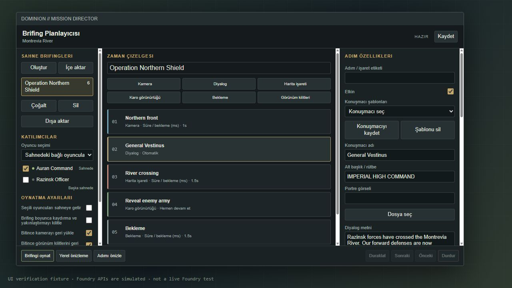
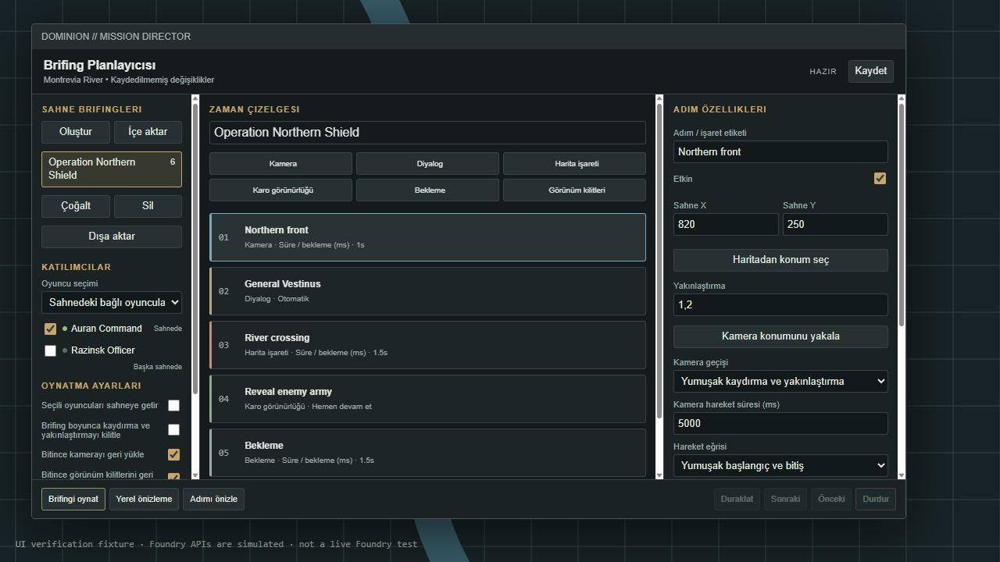

# Dominion Brifing Planlayıcısı

## Forge kurulumu

Forge Bazaar → **Install from Manifest** alanına şu bağlantıyı yapıştırın:

```text
https://github.com/UmutcanOrug/dominion-briefing-planner/releases/latest/download/module.json
```

**Lock View** (`LockView`) 2.x modülünü kurun. Foundry 13 dünyanızda iki modülü de etkinleştirip sayfayı yenileyin. Lock View kullanıcı yapılandırmasında katılacak oyuncular için **Enable** seçeneğini açın. **Control** yetkisini GM ile sınırlayın.

Sahne açıkken Token Controls içindeki uydu anteni düğmesi **Brifing Planlayıcısı** penceresini açar. Foundry arayüz dili Türkçe ise çeviri otomatik yüklenir. SWADE dosyalarında değişiklik gerekmez.

## İlk brifing

1. **Oluştur** ile brifing ekleyip çizelgenin üstünden adını yazın.
2. Kamera, Diyalog, Harita İşareti, Karo Görünürlüğü, Bekleme veya Görünüm Kilitleri adımı ekleyin. Yeni adım seçili kartın arkasına gelir; oklarla sıralanır.
3. **Kamera konumunu yakala** mevcut GM kamera merkezini ve yakınlaştırmasını kaydeder. **Haritadan konum seç** tıklanan sahne koordinatını alır; Escape iptal eder. Kamera geçişini **Yumuşak kaydırma ve yakınlaştırma** seçin. **Kamera hareket süresi** alanında 2000 ms = 2 saniye; 5000 ms = 5 saniye. Daha uzun süre, daha yavaş hareket demektir. **Yumuşak başlangıç ve bitiş** veya **Sabit hız** seçilebilir.
4. Diyaloğa konuşmacı, rütbe, portre ve metin ekleyin. **Dosya seç** Forge Assets uyumlu yerel dosya seçiciyi açar. Seslendirme ve yazma sesi isteğe bağlıdır.
5. Konuşmacıyı tekrar kullanmak için **Konuşmacıyı kaydet** deyin. Şablon uygulanırken değerler kopyalanır; bu adımda yapılan değişiklik diğer mesajları etkilemez. Şablonlar brifinge aittir.
6. **Haritadan karoları seç** ile Tile katmanındaki karoları seçip üstteki onay düğmesine basın. Shift ile çoklu seçim yapabilirsiniz. Göster/gizle/değiştir işlemi gerçek karo belgesini günceller.
7. Katılımcıları seçin. Seçili oyuncular başka sahnedeyse **Seçili oyuncuları sahneye getir** seçeneğini açın. Her oyuncunun haritası hazır olana kadar sınırlı süre beklenir.
8. Normal bitişte karoların ilk duruma dönmesini veya son durumda kalmasını belirleyin. Acil durdurmada ilk durum her zaman geri yüklenir.
9. **Kaydet**, ardından **Yerel önizleme** kullanın. Önizleme oyunculara yayın yapmaz ve karo belgelerini değiştirmez; karo kısmı uyarıyla atlanır.
10. Hazır olduğunuzda **Brifingi oynat** deyin. Canlı brifingi yalnızca aktif GM yönetebilir.

**Otomatik** diyalog yazma/ses süresi ve bekleme dolunca ilerler. **GM Sonraki komutunu bekle** diyaloğu ekranda tutar. Süreler milisaniyedir: 1500 = 1,5 saniye. Kamera adımındaki **Kamera hareket süresi** gerçek kayma süresidir. Alttaki genel **Süre / bekleme** alanı kamera hedefe vardıktan sonraki ek beklemedir. Eski brifinglerin kamera adımları da varsayılan 2 saniyelik yumuşak geçiş alır; isterseniz **Anlık** seçebilirsiniz.

**Duraklat/Sürdür** kamera hareketini, zamanlamayı, yazıyı, işaretleri ve desteklenebilen sesi durdurup sürdürür. **Sonraki** kamera hareketini hedefte tamamlar ve geçerli beklemeyi atlar. **Durdur** geçici efektleri kaldırır ve ilk durumları yükler. **Önceki**, güvenli geri sarma bulunmadığından bu sürümde kapalıdır; durdurup baştan oynatın.

Bir sahnede birden fazla brifing tutulabilir. Kaydetme sahne flag'lerini kullanır; JSON dışa/içe aktarma da mevcuttur. Canlı karo görünürlüğü sahnedeki herkesi etkiler; yalnızca seçili katılımcılarla sınırlanamaz.

## Sınırlar ve kurtarma

Lock View 2.1.0 kaynak kodu incelendi. Kullanılan arayüzler dahili olduğundan çalışma anında uyumluluk kontrol edilir. Yumuşak kamera hareketi ve iki hareket eğrisi desteklenir; yakınlaştırma aralığı 0,05–3'tür. Her ara konum Lock View'ın kendi hareket işleyicisiyle uygulanır ve kilitler her çağrıdan sonra geri yüklenir. Animasyon boyunca Lock View kilitleri açık bırakılmaz. Karo geçiş efekti, sahneler arası çizelge ve sonradan bağlanan oyuncu için otomatik devam bulunmaz.

GM bağlantısı kesilirse oyuncuların geçici efektleri ve kamera kilitleri yaklaşık 25 saniye içinde geri yüklenir. GM sayfası yenilendiyse ilgili sahnede **Oturumu kurtar** düğmesi kayıtlı karo durumunu geri yükler. Lock View dünya ayarları kalıcı olarak değiştirilmez.

**Canlı Foundry V13 / Forge üzerinde iki gerçek oyuncuyla uçtan uca test henüz yapılamadı.** Otomatik testler ve tarayıcıdaki arayüz kontrolü geçti. [Test raporundaki](TESTING.md) gerçek oturum kontrollerini oyun öncesinde uygulayın.




